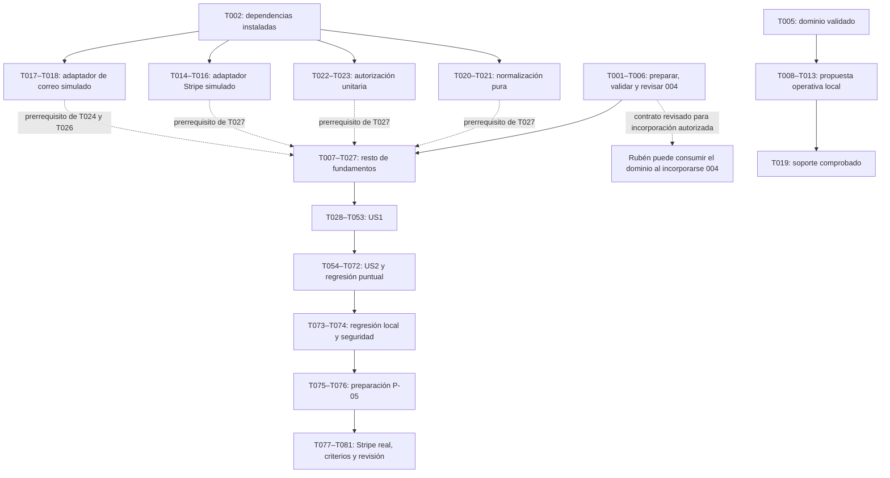

# Tareas de HU-01 — Donación puntual y alta como socio

**Rama**: `spec-001` · **Fecha**: 2026-11-06  
**Responsable**: Nada · **Revisor**: Rubén  
**Estado**: T001–T005 y T008–T044 completadas y verificadas en su alcance. T006 y T007 siguen pendientes, al igual que T045 y posteriores. La numeración 009 es provisional local.

## Backend puntual — T024–T044 · 2026-11-06

Confirmaciones recuperables, preparación/reanudación de Checkout, reconciliación puntual,
resultado privado y vínculo por enlace implementados y comprobados localmente con servicios
externos simulados. La [validación local](refinamiento/validacion-local-01.md)
registra 289 pruebas del módulo tras revisión y 16 del adaptador de correo. No acredita Stripe real,
recepción en buzón, interfaz, aprobación de Rubén ni incorporación compartida.

La reconciliación conserva exclusión por conexión mientras consulta Stripe fuera de una
transacción; después guarda evento, dinero y notificación en una transacción corta. Este
ajuste aplica la condición expresa del bloque y difiere del paso 3 del apartado
«Entregas duplicadas, concurrencia y desorden» del contrato de pasarela, que describía esa consulta dentro de la
transacción. Se registra para revisión sin modificar el contrato ni documentos comunes.
T006 y T007 permanecen pendientes; 009 sigue siendo provisional. No cambian dependencias.

## Entrega temprana de 004 — 2026-11-06

T001–T005 preparan la entrega temprana de 004. La
[ficha de revisión](refinamiento/revision-tecnica-01.md) conserva la revisión de Rubén como
pendiente. El [informe de validación](refinamiento/validacion-004-01.md) registra el fallo
inicial por ausencia de 004 y las 50 pruebas aprobadas después de crearla, sobre dos
esquemas aislados de ong_test_hu01. Node.js y dependencias se han preparado desde los
lockfiles, sin modificarlos; .env queda ignorado y PostgreSQL de Docker usa el puerto 5440.

La validación de 004 no incluyó el bloque B completo, P-05, la suite general, compilación
o Stripe real. Sus resultados e informes se conservan como evidencia de esa entrega.

## Normalización pura — 2026-11-06

T020–T021 incorporan validación de importes y NIF/NIE, normalización de los cinco campos
del donante y comparación de equivalencias, sin persistencia. Se reutilizan los ayudantes
de importes existentes sin modificarlos. Las 102 pruebas dirigidas pasan sin cargar .env,
conectar PostgreSQL o Stripe. El [informe de normalización](refinamiento/validacion-normalizacion-01.md)
conserva los comandos, los fallos anteriores y el resultado final.

Este bloque no incorpora las tablas operativas ni completa otras tareas. T006 sigue
pendiente de la revisión real de Rubén; no se realizan cambios comunes, git add o commit.

## Opciones de correo — 2026-11-06

T017–T018 añaden el segundo argumento opcional de enviarCorreo, conservando el transporte
de las llamadas existentes de un argumento. Los tres tiempos se traducen a las opciones
de Nodemailer en un transporte separado, sin mutar el compartido. Las 16 pruebas del
adaptador pasan con Nodemailer y configuración simulados, sin SMTP real o secretos.
El [informe de correo](refinamiento/validacion-correo-01.md) conserva comandos, resultados
y comprobaciones de formato.

La ampliación queda preparada en spec-001 para revisión, sin acreditar acuerdo colectivo
o incorporación compartida. T006 sigue pendiente de Rubén. No se implementan persistencia
de mensajes, reintentos de negocio, rutas o certificados, ni se completan otras tareas.

## Adaptador de Stripe — 2026-11-06

T014–T016 incorporan el constructor puro, creación compatible con instantánea/clave,
API explícita y consultas proyectadas de Acacia. Las 36 pruebas dirigidas pasan con
peticiones simuladas y firma comprobada por el SDK real, sin cargar .env o contactar Stripe.
El [informe de pasarela](refinamiento/validacion-pasarela-01.md) conserva resultados y límites.
No se implementan persistencia, bloqueos o reconciliación ni se acredita idempotencia real.
La ampliación se prepara para revisión; T006 permanece pendiente de Rubén.

## Autorización aislada — 2026-11-06

T022–T023 incorporan permisos por operación, guardado esperable, origen/CSRF y comprobación
unitaria de propiedad con datos de servidor. Las 35 pruebas dirigidas pasan con sesiones
y datos sintéticos. El [informe de autorización](refinamiento/validacion-autorizacion-01.md)
conserva resultados y límites. No se acredita protección de rutas futuras: al cerrar ese bloque T019 y la
integración estaban pendientes, al igual que la revisión de Rubén de T006.

## Persistencia operativa y soporte — 2026-11-06

T008–T013 crean y validan las cuatro tablas técnicas en la propuesta local 009.
T019 aporta fixtures y soporte comprobados con conexiones PostgreSQL, sesiones separadas
persistidas y simulador de claves compartido entre procesos. La
[validación local](refinamiento/validacion-local-01.md) conserva comandos, resultados y límites.
No equivale a integración funcional: rutas, reconciliación y confirmaciones de correo siguen
pendientes. T006 y T007 no se completan; 009 no está reservada colectivamente.

## Alcance y fuentes

[US1] y [US2] son las dos modalidades de **HU-01**, definidas en [spec.md](spec.md).
No representan HU-01 y HU-02: no se construye historial, certificado, informes, edición de
perfil/cuota o baja desde la aplicación. V1 usa exclusivamente tarjeta mediante Stripe
Checkout, EUR e importe entre 1,00 € y 999.999,99 €, ambos incluidos, máximo dos decimales.
El máximo es propio de la aplicación.

Fuentes vigentes: [plan](plan.md), [research](research.md), [uso del modelo](data-model.md),
[API](contracts/api-donaciones.md), [Stripe](contracts/pasarela-stripe.md),
[cambios comunes](contracts/cambios-comunes.md), [quickstart](quickstart.md),
[plan común](../plan-comun.md), [modelo único](../modelo-datos.md),
[constitución](../../.specify/memory/constitution.md) y [convenciones](../../CONVENCIONES.md).
Los informes históricos de clarify se conservan como evidencia; no sustituyen el estado vigente.

Las rutas de implementación se expresan desde la raíz
`E:\asignaturas\IWeb\Practica grupal\IWEB_ONG`. Incluyen archivos futuros; su mención
no acredita que existan. Cada tarea incluye origen, dependencias y comprobación.
Las tareas de prueba se redactan antes de la implementación que verifican; sus primeros
fallos deben responder al contrato ausente, no a credenciales, base o dependencias omitidas.
[P] indica trabajo en archivos distintos una vez completadas sus dependencias, no ejecución
automática ni modificación concurrente del mismo archivo.

## Límites y coordinación explícitos

- **Revisión compartida**: P-01–P-03 están definidos en esta rama; la revisión de Rubén y
  la coordinación común siguen pendientes. T006 es el control anterior a
  la incorporación compartida de 004 y de esas ampliaciones; no se da por realizado.
  T017–T018 preparan únicamente el adaptador de correo en esta rama para revisión,
  sin acreditar acuerdo colectivo ni incorporación compartida.
- **Autorización independiente**: T022 depende de T002, no de T019. Se prueban
  funciones con sesiones y propiedad sintéticas sin fixtures PostgreSQL. T023 conserva
  su dependencia de T022. T019 mantiene su dependencia de T013; la integración posterior sigue pendiente; no se modifican autenticación, cookies, roles o rutas.
- **Pasarela independiente**: T014 depende de T002, no de T013. El constructor puro,
  la firma local y las peticiones simuladas no necesitan tablas operativas. T015 sigue
  dependiendo de T014 y T016 de T015; T027 conserva sus requisitos de integración.
  Preparar esta ampliación en la rama no completa T006 ni acredita Stripe real.
- **Correo independiente**: T017 depende de T002, no de T013. Nodemailer y la
  configuración se simulan para comprobar el adaptador sin SMTP real, secretos o
  tablas operativas. T018 conserva su dependencia de T017; las dependencias de T024
  y T026 no cambian. No se adelantan persistencia o reintentos de negocio.
- **Normalización independiente**: T020 depende de T002, no de T013. Sus pruebas y las
  funciones puras de T021 no usan base de datos, tablas operativas o Stripe; pueden
  prepararse con las dependencias instaladas. T021 conserva su dependencia de T020 y
  T027 sigue requiriendo T021. El ajuste no completa T006 ni adelanta cambios comunes.
- **Migración operativa provisional**: 009_operativa_donaciones.sql se prepara localmente
  en esta rama sin reserva colectiva. LEEME y la ficha de revisión registran su carácter
  provisional. T008 depende de T005 para este desarrollo local; T009–T013 mantienen
  su cadena y T019 espera a T013. T006 y T007 siguen pendientes y son requisitos anteriores
  a la incorporación compartida. Las cuatro tablas solo dependen de 004, no de 006–008.
- **Validación temprana**: quickstart B exige las siete tablas y los archivos de pruebas de
  HU-01. Ejecutarlo completo antes de la ampliación operativa bloquearía la entrega de 004.
  T005 usa selección segura de conexión y una prueba dirigida de migración;
  T073 usa después B completo. No se cambian silenciosamente las decisiones o la guía.
- **Evidencias**: los informes de ejecución citados son destinos futuros. Se añaden entradas
  fechadas y resultados reales, sin sobrescribir informes previos. No se atribuyen acuerdos
  colectivos, comprobaciones de cuenta o resultados de pruebas que no existan.
- **Correcciones de analyze-1**: COV-001 queda concretado en las entradas T045/T047 y
  el estado inicial/solicitud de T049; T031/T052 cubren P11/P12 completos. UND-001 define
  exclusión por conexión, snapshot y ventana fija en T008/T009/T014/T015/T029/T034–T036.
  Se conserva el informe inicial y el registro de hallazgos distingue diseño de ejecución.
- **Integración real de ciclos**: un evento sintético ajeno o una factura manual no demuestra
  un ciclo real del contrato. Si no se dispone de ese ciclo, su comprobación real permanece
  pendiente aunque la prueba local pase. No se introduce un modo de pago ficticio o un nuevo
  contrato de Stripe para ocultar esa limitación.

## Distribución

| Grupo                                          | Identificadores | Tareas |
| ---------------------------------------------- | --------------- | ------ |
| 1. Preparación y entrega temprana de 004       | T001–T006       | 6      |
| 2. Fundamentos compartidos de HU-01            | T007–T027       | 21     |
| 3. [US1] Donación puntual — prioridad P1       | T028–T053       | 26     |
| 4. [US2] Alta y cuotas de socio — prioridad P1 | T054–T072       | 19     |
| 5. Validación final: local, P-05 y Stripe real | T073–T081       | 9      |
| **Total**                                      | **T001–T081**   | **81** |

## Fase 1. Preparación y entrega temprana de 004

**Objetivo**: Preparar el contrato de dominio que desbloquea a Rubén, validarlo de forma aislada y obtener revisión antes de su incorporación.

**Comprobación del incremento**: 004 revisada, con pruebas propias sobre ambas secuencias; todavía no se necesita la migración operativa, UI ni Stripe real.

- [x] T001 Preparar la ficha de revisión de P-01–P-03 y del contrato de consulta de 004, distinguiendo diseño de rama y acuerdos pendientes. Archivos: `specs/spec-001/refinamiento/revision-tecnica-01.md`.
      **Origen**: Constitución X–XII; P-01–P-03; FR-006, FR-010. **Depende de**: ninguna.
      **Comprobación**: La ficha identifica a Nada y Rubén, enlaza modelo/contratos vigentes y no da por realizada una revisión sin evidencia.

- [x] T002 Preparar Node.js 22, dependencias desde los lockfiles y la base exclusiva ong_test_hu01 siguiendo quickstart A y la selección de conexión de B. Archivos: `specs/spec-001/quickstart.md`, `backend/package-lock.json`, `frontend/package-lock.json`, `.env`.
      **Origen**: Plan: contexto y validación; SC-002, SC-004. **Depende de**: T001.
      **Comprobación**: DATABASE_URL y TEST_DATABASE_URL seleccionan la base real de pruebas; se conserva .env y no se muestran secretos. No se exige P-05 para la suite simulada.

- [x] T003 Escribir las pruebas de 004 con dos esquemas aislados dentro de la base de pruebas: 001–003 → 004 y 001–003/005 → 004. Archivos: `backend/src/modulos/donaciones/migraciones.test.js`.
      **Origen**: P-01; FR-002, FR-006, FR-010; SC-004. **Depende de**: T002.
      **Comprobación**: Los casos comprueban tres tablas, FKs, auditoría, nulabilidad, índice financiero y claves únicas de NIF/pago/factura, sin UNIQUE de correo; fallan si falta 004, no por conexión ausente.

- [x] T004 Crear exclusivamente las tres tablas de dominio de 004 según el modelo común, incluidos límite individual, claves externas y previsión temporal. Archivos: `backend/src/db/migraciones/004_donaciones.sql`.
      **Origen**: P-01; FR-002, FR-006, FR-008, FR-010, FR-019. **Depende de**: T003.
      **Comprobación**: El SQL coincide con el modelo vigente, no incluye tablas operativas ni altera 001–003/005 y no limita los totales acumulados.

- [x] T005 Validar las dos secuencias de 004 y la selección de migraciones pendientes por nombre; conservar la evidencia de la entrega temprana. Archivos: `backend/src/modulos/donaciones/migraciones.test.js`, `backend/src/db/migrar.js`, `specs/spec-001/refinamiento/validacion-004-01.md`.
      **Origen**: P-01; FR-006, FR-010; SC-004. **Depende de**: T004.
      **Comprobación**: La prueba dirigida pasa en ambos esquemas; una segunda ejecución del migrador no reaplica 004 registrada. El bloque B completo no se usa aún y no se modifica el migrador para forzar el resultado.

- [ ] T006 Registrar la revisión de Rubén de 004, sus evidencias y los cambios comunes P-01–P-03 antes de preparar su incorporación. Archivos: `specs/spec-001/refinamiento/revision-tecnica-01.md`, `specs/spec-001/refinamiento/validacion-004-01.md`, `backend/src/db/migraciones/LEEME.md`.
      **Origen**: Constitución XI–XII; P-01–P-03; FR-006, FR-010. **Depende de**: T001, T005.
      **Comprobación**: Se registran resultado y observaciones reales, incluida la coordinación común exigible. Si hay reparos, la tarea sigue abierta. La entrega queda revisada para desbloquear a Rubén; no se hace commit, push o merge automáticamente.

## Fase 2. Fundamentos compartidos de HU-01

**Objetivo**: Completar persistencia técnica, envolturas compatibles, normalización, permisos y correo antes de las modalidades.

**Comprobación del incremento**: Tablas y contratos locales comprobables sin cuenta Stripe. Se reutilizan autenticación, roles, sesiones, importes, fechas, errores y componentes existentes.

- [ ] T007 Coordinar y registrar el número libre y el nombre completo de la migración operativa posterior a 004. Archivos: `backend/src/db/migraciones/LEEME.md`, `specs/spec-001/refinamiento/revision-tecnica-01.md`.
      **Origen**: P-01; plan: incorporación en dos entregas; FR-010, FR-013. **Depende de**: T006.
      **Comprobación**: El nombre concreto se registra sin colisión, con número disponible desde 009; no se presenta 009 como reservado ni se reescribe 004 incorporada.

- [x] T008 Añadir los casos de esquema para las cuatro tablas técnicas y su dependencia exclusiva de 004. Archivos: `backend/src/modulos/donaciones/migraciones.test.js`.
      **Origen**: P-01; FR-010, FR-012, FR-013, FR-016. **Depende de**: T005.
      **Comprobación**: Se comprueban unicidad de solicitud, evento, token y pareja aportación/tipo, solicitud_checkout JSONB no nulo y restricciones. La instantánea se justifica para reanudación; no hay tabla de locks/lease de creación ni dependencia de 006–008.

- [x] T009 Añadir operaciones_pago y solicitud_checkout a la propuesta local 009_operativa_donaciones.sql. Archivos: `backend/src/db/migraciones/009_operativa_donaciones.sql`, `backend/src/db/migraciones/LEEME.md`.
      **Origen**: P-01; FR-010, FR-016. **Depende de**: T008.
      **Comprobación**: La sección SQL coincide con el modelo único, usa el fichero provisional registrado en LEEME; T007 sigue pendiente y no duplica datos de bloqueo. El cuerpo persistido no contiene NIF/dirección, sesión, secretos o tarjeta; 004 no cambia.

- [x] T010 Añadir eventos_pasarela y sus restricciones a la propuesta local 009_operativa_donaciones.sql. Archivos: `backend/src/db/migraciones/009_operativa_donaciones.sql`, `backend/src/db/migraciones/LEEME.md`.
      **Origen**: P-01; FR-010, FR-017. **Depende de**: T009.
      **Comprobación**: La sección SQL coincide con la definición única de eventos_pasarela; usa el fichero provisional registrado en LEEME, con T007 pendiente, sin crear otra migración o duplicar entidades.

- [x] T011 Añadir verificaciones_donante y sus restricciones a la propuesta local 009_operativa_donaciones.sql. Archivos: `backend/src/db/migraciones/009_operativa_donaciones.sql`, `backend/src/db/migraciones/LEEME.md`.
      **Origen**: P-01; FR-013. **Depende de**: T010.
      **Comprobación**: La sección SQL coincide con la definición única de verificaciones_donante; usa el fichero provisional registrado en LEEME, con T007 pendiente, sin crear otra migración o duplicar entidades.

- [x] T012 Añadir correos_aportacion y sus restricciones a la propuesta local 009_operativa_donaciones.sql. Archivos: `backend/src/db/migraciones/009_operativa_donaciones.sql`, `backend/src/db/migraciones/LEEME.md`.
      **Origen**: P-01; FR-007, FR-012, FR-018. **Depende de**: T011.
      **Comprobación**: La sección SQL coincide con la definición única de correos_aportacion; usa el fichero provisional registrado en LEEME, con T007 pendiente, sin crear otra migración o duplicar entidades.

- [x] T013 Validar la ampliación operativa y comprobar que 004 permanece intacta tras la ampliación local. Archivos: `backend/src/modulos/donaciones/migraciones.test.js`, `backend/src/db/migraciones/LEEME.md`, `specs/spec-001/refinamiento/validacion-local-01.md`.
      **Origen**: P-01; FR-010, FR-012, FR-013, FR-016. **Depende de**: T012.
      **Comprobación**: La suite dirigida valida las siete tablas de donaciones en la base exclusiva y la reejecución respeta el registro de migraciones.

- [x] T014 [P] Escribir pruebas de la envoltura Stripe sin red: creación idempotente, card/eur, metadatos propagados, firma y proyecciones canónicas. Archivos: `backend/src/modulos/donaciones/pasarela.test.js`.
      **Origen**: P-02, P-04; FR-005, FR-006, FR-010; SC-003, SC-004. **Depende de**: T002.
      **Comprobación**: Recursos Acacia y secretos sintéticos prueban prepararSesionPago sin red y la creación con instantánea original, incluso tras cambiar configuración; misma clave/cuerpo, 3000 ms, cero reintentos y proyecciones sin tarjeta.

- [x] T015 Añadir el preparador puro y la creación con solicitudCheckout persistida, preservando la firma anterior y la salida id/url. Archivos: `backend/src/servicios-comunes/pasarela.js`.
      **Origen**: P-02, P-04; FR-001, FR-005, FR-010. **Depende de**: T014.
      **Comprobación**: HU-01 no reconstruye el cuerpo al reintentar: modo, tres recurrencias, card/EUR, una línea, metadatos protegidos y URL originales coinciden; llamadas compatibles sin instantánea usan el mismo preparador.

- [x] T016 Añadir las consultas de Session, PaymentIntent, Invoice y Subscription del plan común, incluido listado acotado de Session por suscripción. Archivos: `backend/src/servicios-comunes/pasarela.js`.
      **Origen**: P-02; FR-006, FR-009, FR-010, FR-018, FR-019. **Depende de**: T015.
      **Comprobación**: Las pruebas cubren nulls, campos Acacia y límite 2 sin paginación automática; error transitorio es 503 y solo esta envoltura importa Stripe.

- [x] T017 [P] Escribir pruebas de compatibilidad de enviarCorreo con y sin opciones propias de HU-01. Archivos: `backend/src/servicios-comunes/correo.test.js`.
      **Origen**: P-03; FR-007, FR-012. **Depende de**: T002.
      **Comprobación**: Se comprueban retorno booleano, traducción de los tres tiempos, transporte ajeno sin mutar y fallo SMTP que no se presenta como éxito.

- [x] T018 Añadir el segundo argumento opcional de tiempos SMTP, conservando el comportamiento de las llamadas actuales sin opciones. Archivos: `backend/src/servicios-comunes/correo.js`.
      **Origen**: P-03; FR-007, FR-012. **Depende de**: T017.
      **Comprobación**: Los casos anteriores y nuevos pasan; HU-01 puede solicitar conexión/saludo de 3000 ms e inactividad de 5000 ms sin alterar otros módulos.

- [x] T019 [P] Preparar fixtures de usuarios, donantes, recursos canónicos y sesiones separadas para la integración local. Archivos: `backend/src/modulos/donaciones/pruebas/soporte.js`.
      **Origen**: Quickstart B; FR-010, FR-013, FR-016, FR-017. **Depende de**: T013.
      **Comprobación**: Falta de TEST_DATABASE_URL/esquema falla, no omite. Los fixtures controlan dos conexiones y reinicio de proceso con base/secreto de sesión conservados y simulador Stripe persistente por clave, sin contactar Stripe ni modificar pruebas ajenas.

- [x] T020 [P] Escribir casos de normalización y límites de importe, sin confundir diferencias de formato y cambios reales. Archivos: `backend/src/modulos/donaciones/normalizacion.test.js`.
      **Origen**: FR-002, FR-004, FR-015; P03, P04, P17. **Depende de**: T002.
      **Comprobación**: Se incluyen extremos 1.00/999999.99, coma, tres decimales, exponente, NIF/NIE con letra, NFC, espacios, mayúsculas y conservación de tildes/puntuación.

- [x] T021 Implementar las equivalencias del research reutilizando los ayudantes comunes de importes y sin sobrescribir Donante. Archivos: `backend/src/modulos/donaciones/normalizacion.js`.
      **Origen**: FR-002, FR-004, FR-015; P03, P04, P17. **Depende de**: T020.
      **Comprobación**: Los casos de formato pasan y todo cambio real sigue siendo distinto; conversión en céntimos enteros, sin redondear entradas inválidas.

- [x] T022 Escribir casos de permiso por operación y cuenta vinculada, CSRF, origen y caducidad absoluta. Archivos: `backend/src/modulos/donaciones/autorizacion.test.js`.
      **Origen**: FR-011, FR-013, FR-016; P11, P18, P19, P20. **Depende de**: T002.
      **Comprobación**: Referencia, UUID, cookie sin permiso y correo coincidente no autorizan; la operación A no concede B y el acceso de cuenta exige rol y vínculo.

- [x] T023 Implementar permisos de sesión por referencia, guardado previo a redirección y comprobación de propiedad en servidor. Archivos: `backend/src/modulos/donaciones/autorizacion.js`.
      **Origen**: FR-011, FR-013, FR-016; PA1.7. **Depende de**: T022.
      **Comprobación**: Caducidad absoluta de ocho horas, POST con origen/CSRF y 404 genérico para recurso no autorizado; no cambia login, cookie común o roles.

- [x] T024 Escribir los casos de resumen inmutable, envío, fallo, reintento y reserva renovable de correo. Archivos: `backend/src/modulos/donaciones/confirmaciones.test.js`.
      **Origen**: FR-007, FR-012, FR-018; P06–P10. **Depende de**: T019, T018.
      **Comprobación**: Dos solicitudes reclaman un solo intento; la renovación y el guardado usan el número reclamado, y una caída SMTP no altera dinero ni promete entrega única.

- [x] T025 Añadir persistencia de mensajes y reclamación transaccional por aportación/tipo con número de intento. Archivos: `backend/src/modulos/donaciones/repositorio.js`.
      **Origen**: P-01, P-03; FR-007, FR-012, FR-018. **Depende de**: T024.
      **Comprobación**: Pruebas con PostgreSQL verifican unicidad, reserva de treinta segundos, renovación y rechazo de escrituras de un intento antiguo.

- [x] T026 Implementar el envío posterior al commit y el reintento del mismo resumen con las opciones SMTP de HU-01. Archivos: `backend/src/modulos/donaciones/confirmaciones.js`.
      **Origen**: FR-007, FR-012, FR-018; SC-002. **Depende de**: T025, T018.
      **Comprobación**: Se renueva cada diez segundos mientras vive el intento; éxito/fallo se persisten sin llamadas de cobro, enviado no se reenvía y true no se considera prueba de recepción.

- [x] T027 Preparar la entrada del módulo y registrar rutasDonaciones, manteniendo cuerpo crudo antes de JSON en el webhook. Archivos: `backend/src/modulos/donaciones/rutas.js`, `backend/src/modulos/donaciones/controlador.js`, `backend/src/modulos/donaciones/servicio.js`, `backend/src/app.js`, `backend/src/modulos/donaciones/registro.test.js`.
      **Origen**: P-02; FR-005, FR-016, FR-017. **Depende de**: T016, T021, T023, T026, T019.
      **Comprobación**: La aplicación carga con asincrono/ErrorApi comunes; auth/proyectos/actividades mantienen rutas y el webhook no queda sujeto a un requisito de sesión.

## Fase 3. [US1] Donación puntual — prioridad P1

**Objetivo**: Completar donación puntual sin cuenta, confirmación privada por operación, vínculo acreditado y reintento exclusivo del correo.

**Comprobación del incremento**: Tras fundamentos, P01–P21 se comprueban con PostgreSQL y pasarela simulada: una donación de 20 € produce una sola aportación y resumen propio; los accesos ajenos se deniegan. La recepción efectiva en buzón y Checkout real se verifican en la fase final.

- [x] T028 [US1] Escribir los casos de conflicto/reutilización de Donante y sus carreras concurrentes. Archivos: `backend/src/modulos/donaciones/servicio.test.js`.
      **Origen**: FR-014, FR-015; P13–P17. **Depende de**: T027.
      **Comprobación**: Correo con otro NIF y NIF con datos reales distintos se rechazan sin Stripe o escrituras; formato equivalente reutiliza sin actualizar; dos altas simultáneas no mezclan identidades.

- [x] T029 [US1] Escribir los contratos de contexto y creación puntual, proyecto activo, validación y clave de solicitud. Archivos: `backend/src/modulos/donaciones/rutas.test.js`, `backend/src/modulos/donaciones/servicio.test.js`.
      **Origen**: FR-001–FR-005, FR-010, FR-011; P01–P04, P07. **Depende de**: T028.
      **Comprobación**: Validación/CSRF preceden a Stripe; proyecto desactivado exige elección en alta nueva. Concurrencia devuelve 409 en curso; timeout y reinicio conservan UUID, referencia, huella e instantánea. Se prueban DTO corto autorizado, UUID equivalente en mayúsculas/minúsculas con igual lock/clave, cuerpo incompatible, pérdida de conexión, finally/release(true) y límite fijo de 23 horas sin otro POST; ocho horas del invitado no se amplían.

- [x] T030 [US1] Escribir los casos de confirmación/rechazo puntual, firma, pertenencia y desorden de notificaciones. Archivos: `backend/src/modulos/donaciones/pasarela.test.js`, `backend/src/modulos/donaciones/eventos.test.js`.
      **Origen**: FR-006, FR-010, FR-017; P05, P21; SC-004. **Depende de**: T029.
      **Comprobación**: Mismo o distinto event ID, entregas simultáneas, rechazo→éxito del mismo PaymentIntent y fallo antiguo mantienen una fila; versión/importe/moneda incorrectos no confirman y fallo transitorio no deja evento procesado.

- [x] T031 [US1] Añadir contratos de resultado, reintento de correo y vínculo por enlace, incluidas pruebas de acceso denegado. Archivos: `backend/src/modulos/donaciones/rutas.test.js`.
      **Origen**: FR-007, FR-011–FR-013, FR-016; P06–P12, P18–P20. **Depende de**: T030.
      **Comprobación**: Se cubren SMTP, accesos propios/ajenos y tokens. Solicitud autenticada devuelve el mismo 202 genérico con/sin Donante, sin vínculo; GET no envía, abrir token no reemite y la confirmación exige misma cuenta/uso único. P11/P12 se conectan con la prueba visible de T052.

- [x] T032 [US1] Añadir búsquedas normalizadas y alta/reutilización de Donante con bloqueo ordenado por NIF y correo. Archivos: `backend/src/modulos/donaciones/repositorio.js`.
      **Origen**: FR-014, FR-015; P13–P17. **Depende de**: T028.
      **Comprobación**: PostgreSQL mantiene un solo Donante para datos equivalentes y no sobrescribe filas en conflictos o carreras.

- [x] T033 [US1] Aplicar la comparación de identidad y el conflicto genérico antes de iniciar cualquier pago. Archivos: `backend/src/modulos/donaciones/servicio.js`.
      **Origen**: FR-004, FR-014, FR-015; P13–P17. **Depende de**: T032, T021.
      **Comprobación**: Los casos de identidad pasan también para una cuenta vinculada; no se revelan datos guardados ni se habilita edición de perfil.

- [x] T034 [US1] Añadir preparación atómica por UUID, validación de Proyecto para alta nueva y persistencia inmutable de entrada/snapshot, junto al control de exclusión por cliente. Archivos: `backend/src/modulos/donaciones/repositorio.js`.
      **Origen**: FR-003, FR-006, FR-010, FR-016; P01, P02, P18. **Depende de**: T033, T029.
      **Comprobación**: La preparación usa pg_try_advisory_xact_lock y libera al commit; creación usa pg_try_advisory_lock en cliente propio, tras guardar sesión. Operación existente no recrea filas o snapshot. Guardado/desbloqueo usan ese cliente; finally libera o destruye y no retorna un cliente con lock pendiente.

- [x] T035 [US1] Orquestar la creación/reanudación de Checkout con el protocolo de exclusión y la misma instantánea de solicitud. Archivos: `backend/src/modulos/donaciones/servicio.js`.
      **Origen**: FR-002, FR-003, FR-005, FR-010, FR-011; P01–P03, P07. **Depende de**: T034.
      **Comprobación**: No hay transacción durante HTTP ni segunda conexión dentro del tramo. Actividad se acredita por lock, no por incierta. Tras error/reinicio solo readquiere con permiso y antes de creado_en + 23 horas; no renueva fecha ni UUID/cuerpo. Sin ID y vencida exige revisión; con Session conocida solo consulta/reutiliza. Respuesta tardía no reabre cerrada/confirmada.

- [x] T036 [US1] Implementar contexto, creación puntual y reanudación por DTO corto autorizado con zod y respuestas del contrato. Archivos: `backend/src/modulos/donaciones/controlador.js`, `backend/src/modulos/donaciones/rutas.js`.
      **Origen**: FR-001–FR-005, FR-011; P01–P04, P07. **Depende de**: T035.
      **Comprobación**: Supertest comprueba 201/200/400/403/404/409/503, OPERACION_EN_CURSO y OPERACION_REQUIERE_REVISION. DTO corto no crea sin una operación propia previa; el completo distinto entra en conflicto. No se aceptan IDs de persona o solicitudCheckout del cliente y preparacion devuelve plazo derivado sin renovar permisos.

- [x] T037 [US1] Añadir bloqueo por pago y registro atómico de evento junto con la transición financiera y la notificación. Archivos: `backend/src/modulos/donaciones/repositorio.js`.
      **Origen**: FR-006, FR-007, FR-010, FR-017; P21. **Depende de**: T030, T036.
      **Comprobación**: Rollback no deja evento procesado; las claves únicas de evento y pago se verifican por separado y el commit no depende de SMTP.

- [x] T038 [US1] Implementar reconciliación puntual con PaymentIntent actual y fecha del evento firmado de éxito. Archivos: `backend/src/modulos/donaciones/servicio.js`.
      **Origen**: FR-006, FR-007, FR-010, FR-017; P05, P21; SC-004. **Depende de**: T037.
      **Comprobación**: El mismo rechazo pasa a confirmado sin duplicar referencia; confirmado no retrocede, cancel_url no prueba cancelación y evento ajeno/discrepancia no se registra como cobro.

- [x] T039 [US1] Implementar POST webhook con firma, cuerpo crudo y respuestas para reentrega/duplicado/incidencia. Archivos: `backend/src/modulos/donaciones/controlador.js`, `backend/src/modulos/donaciones/rutas.js`.
      **Origen**: FR-005, FR-006, FR-010, FR-017; P21. **Depende de**: T038.
      **Comprobación**: Sin cookie se confirma una vez; firma inválida es 400, fallo transitorio sin commit es 503 y fallo de correo posterior no cambia el cobro ni el 200.

- [x] T040 [US1] Implementar consulta autorizada de una aportación con proyección mínima y Cache-Control no-store. Archivos: `backend/src/modulos/donaciones/repositorio.js`, `backend/src/modulos/donaciones/servicio.js`, `backend/src/modulos/donaciones/controlador.js`, `backend/src/modulos/donaciones/rutas.js`.
      **Origen**: FR-006, FR-007, FR-016; P01, P02, P18–P20. **Depende de**: T039, T031.
      **Comprobación**: Resumen, importe y fecha coinciden con el registro propio; 404 no distingue ajeno/inexistente, no hay datos fiscales y un GET no muta dinero.

- [x] T041 [US1] Implementar POST de reintento exclusivo de confirmación usando autorización y CSRF. Archivos: `backend/src/modulos/donaciones/servicio.js`, `backend/src/modulos/donaciones/controlador.js`, `backend/src/modulos/donaciones/rutas.js`.
      **Origen**: FR-007, FR-012, FR-016; P08–P10, P18–P20. **Depende de**: T040.
      **Comprobación**: Fallo sigue pendiente; envío reservado es 409, enviado no se repite y en ningún caso se crean cobros, aportaciones o suscripciones.

- [x] T042 [US1] Añadir emisión, invalidación y consumo transaccional de la prueba ligada a Usuario y Donante. Archivos: `backend/src/modulos/donaciones/repositorio.js`.
      **Origen**: FR-011, FR-013; P11, P12. **Depende de**: T041.
      **Comprobación**: Solo se guarda hash; expiración/uso/cuenta se comprueban bajo bloqueo y consumo+usuario_id se guardan atómicamente.

- [x] T043 [US1] Implementar solicitud autenticada de enlace al correo de la cuenta coincidente, con respuesta no enumerativa. Archivos: `backend/src/modulos/donaciones/servicio.js`, `backend/src/modulos/donaciones/controlador.js`, `backend/src/modulos/donaciones/rutas.js`.
      **Origen**: FR-011, FR-013; P11, P12. **Depende de**: T042.
      **Comprobación**: Token de 32 bytes y treinta minutos, destino tomado de la cuenta y no del cliente. Se verifica 401/403, 202 idéntico con/sin Donante elegible y ante fallo SMTP individual, error de infraestructura genérico y ausencia de vínculo por solicitud; no se envía automáticamente al entrar.

- [x] T044 [US1] Implementar confirmación POST del enlace de uso único para la cuenta solicitante. Archivos: `backend/src/modulos/donaciones/servicio.js`, `backend/src/modulos/donaciones/controlador.js`, `backend/src/modulos/donaciones/rutas.js`.
      **Origen**: FR-013; P11, P12. **Depende de**: T043.
      **Comprobación**: Otra cuenta, caducidad, repetición y carrera de consumo no vinculan; abrir la página por GET no consume; registro/login/roles permanecen intactos.

- [ ] T045 [P] [US1] Crear la isla del formulario puntual con datos mínimos, selección expresa de destino y entrada visible de vinculación. Archivos: `frontend/src/components/donaciones/FormDonacion.jsx`.
      **Origen**: FR-001–FR-005, FR-011, FR-014, FR-015; P01–P04, P07, P13–P17. **Depende de**: T044.
      **Comprobación**: Reutiliza Campo/Boton/Aviso, api.js y formato.js. Ofrece «Vincular mis aportaciones a una cuenta» a /donar/vincular sin HU-02. Conserva solo UUID de la operación en sessionStorage; recarga usa DTO corto, no rota clave por error ni guarda datos fiscales o tarjeta allí.

- [ ] T046 [US1] Montar /donar con Layout.astro y la isla del formulario. Archivos: `frontend/src/pages/donar/index.astro`.
      **Origen**: FR-001, FR-011; P01, P07. **Depende de**: T045.
      **Comprobación**: La ruta pública renderiza el formulario sin exigir cuenta, sin alterar páginas o permisos de otros módulos.

- [ ] T047 [P] [US1] Crear la isla de resultado, reintento exclusivo de correo y entrada visible de vinculación. Archivos: `frontend/src/components/donaciones/ResultadoDonacion.jsx`.
      **Origen**: FR-006, FR-007, FR-012, FR-016; P01, P02, P05, P08–P10, P18–P20; SC-004. **Depende de**: T044.
      **Comprobación**: Pago/envío separados; cancelado=1 no cambia dinero. Enlace a /donar/vincular siempre visible, sin revelar datos. preparacion permite reanudar la misma operación autorizada, nunca otra clave; revisión requerida desactiva creación. Consulta y correo siguen limitados por permiso, con el mismo resumen y resultado real.

- [ ] T048 [US1] Montar /donar/resultado con Layout y referencia tratada solo como identificador. Archivos: `frontend/src/pages/donar/resultado.astro`.
      **Origen**: FR-007, FR-016; P18–P20. **Depende de**: T047.
      **Comprobación**: Un navegador sin permiso recibe aviso genérico sin resumen, sin recuperación invitada ni acceso a otras operaciones.

- [ ] T049 [P] [US1] Crear /donar/vincular y su isla con estados sin token, solicitud autenticada y confirmación con token. Archivos: `frontend/src/components/donaciones/VincularDonante.jsx`, `frontend/src/pages/donar/vincular.astro`.
      **Origen**: FR-011, FR-013; P11, P12. **Depende de**: T044.
      **Comprobación**: Desde ambas entradas se llega sin HU-02. Sin token: FormEntrar existente, contexto/CSRF y botón Enviar enlace de verificación; 202 muestra aviso genérico idéntico, no acredita envío/vínculo. Con token: retira fragmento, sessionStorage y Confirmar vinculación por POST; GET no envía/consume. Caducado/usado permite Solicitar otro explícitamente. Sin perfil, roles o registro nuevos.

- [ ] T050 [US1] Añadir Donantes y aportaciones sintéticas para comprobar resultados propios y ajenos sin llamar a Stripe. Archivos: `backend/src/db/semillas/donaciones.js`, `backend/src/db/semillas/index.js`.
      **Origen**: Plan común §8; FR-007, FR-014, FR-015, FR-016. **Depende de**: T046, T048, T049.
      **Comprobación**: Se ejecutan dos veces sin duplicar; conservan casos inicialmente no vinculados y semillas ajenas, sin credenciales reales ni cargos.

- [ ] T051 [US1] Añadir el acceso público a /donar conservando las opciones y permisos existentes. Archivos: `frontend/src/components/comunes/Menu.jsx`.
      **Origen**: P-02; FR-001, FR-011; P07. **Depende de**: T050.
      **Comprobación**: Invitado y cuenta pueden abrir formulario; no aparecen historial HU-02 ni acciones de edición de socio.

- [ ] T052 [US1] Revisar interfaz puntual, validaciones y estados de datos sintéticos sin efectuar un Checkout real. Archivos: `frontend/src/components/donaciones/FormDonacion.jsx`, `frontend/src/components/donaciones/ResultadoDonacion.jsx`, `frontend/src/components/donaciones/VincularDonante.jsx`, `specs/spec-001/refinamiento/validacion-local-01.md`.
      **Origen**: FR-002, FR-007, FR-012, FR-013, FR-016; P03, P04, P08–P12, P18–P20. **Depende de**: T051.
      **Comprobación**: Recorrer P11/P12 desde formulario y desde resultado: sin token, login, solicitud, aviso genérico, correo Mailpit y confirmación de la misma cuenta; rechazar otra cuenta/caducidad/uso. La comprobación de vínculo es local y no requiere Stripe. Verificar también clave conservada tras recarga, error en curso/revisión y ausencia de nueva operación automática; semillas no prueban cobros reales.

- [ ] T053 [US1] Ejecutar las pruebas locales de US1, la integración común disponible y la compilación del frontend; registrar resultados reales. Archivos: `backend/src/modulos/donaciones/servicio.test.js`, `backend/src/modulos/donaciones/rutas.test.js`, `backend/src/modulos/donaciones/pasarela.test.js`, `specs/spec-001/refinamiento/validacion-local-01.md`.
      **Origen**: FR-001–FR-007, FR-010–FR-017; P01–P21; SC-003, SC-004. **Depende de**: T052.
      **Comprobación**: P01–P21 tienen resultado documentado con pasarela simulada; conexión/esquema ausentes fallan, no omiten casos. SC-001/SC-002 y Stripe real no se declaran por estas pruebas.

## Fase 4. [US2] Alta y cuotas de socio — prioridad P1

**Objetivo**: Reutilizar el flujo anterior para alta mensual/trimestral/anual, primera cuota, ciclos, fallos y cancelación comunicada.

**Comprobación del incremento**: S01–S13 usan fixtures propios de socio: primera cuota única, ciclos deduplicados y fallo sin sumar ni cancelar por sí solo. No requieren efectuar una donación puntual real ni implementar HU-02.

- [ ] T054 [US2] Escribir los casos del alta en tres periodicidades, primer cobro fallido, datos incompatibles y ausencia de cuenta. Archivos: `backend/src/modulos/donaciones/servicio.test.js`.
      **Origen**: FR-001–FR-006, FR-008, FR-011, FR-014, FR-015; S01, S03, S04, S07, S08. **Depende de**: T053.
      **Comprobación**: Se aceptan extremos de importe y las tres recurrencias; conflicto detiene antes de Stripe y primer rechazo no deja alta activa ni cuota confirmada.

- [ ] T055 [US2] Escribir los casos de primera factura, ciclos, reentregas y secuencias desordenadas de cuotas. Archivos: `backend/src/modulos/donaciones/pasarela.test.js`.
      **Origen**: FR-008–FR-010, FR-017; S01–S03, S09; SC-004. **Depende de**: T054.
      **Comprobación**: Invoice antes/después de Checkout y ciclo antes del aviso inicial no duplican; factura/pago recuperados se verifican, factura ajena/discrepante no suma y fallo→éxito reutiliza fila.

- [ ] T056 [US2] Añadir casos de fallo posterior, previsión futura/nula/vencida y cancelación efectiva o programada. Archivos: `backend/src/modulos/donaciones/servicio.test.js`.
      **Origen**: FR-008, FR-018, FR-019; S10–S13. **Depende de**: T055.
      **Comprobación**: Los casos conservan totales anteriores, actualizan desde invoice.updated, no inventan fechas y un evento antiguo no reactiva ni anuncia un cobro posterior a cancelación.

- [ ] T057 [US2] Añadir casos de correo de cuota y permisos diferentes entre alta invitada y cuotas posteriores. Archivos: `backend/src/modulos/donaciones/rutas.test.js`.
      **Origen**: FR-007, FR-012, FR-016; S05, S06. **Depende de**: T056.
      **Comprobación**: El fallo conserva alta y pago; solo cuenta vinculada propia o permiso de esa operación puede reintentar, sin cargo ni otra suscripción; la sesión del alta no autoriza ciclos.

- [ ] T058 [US2] Añadir persistencia de suscripción pendiente y referencia externa, manteniendo las reglas del modelo común. Archivos: `backend/src/modulos/donaciones/repositorio.js`.
      **Origen**: FR-008, FR-010; S01, S03. **Depende de**: T054, T055, T056, T057.
      **Comprobación**: Creación atómica de alta/cuota inicial, identificador único nullable hasta conocerlo y sin fecha de alta antes del primer cobro.

- [ ] T059 [US2] Extender la preparación para crear una sola alta, aportación inicial y operación antes de Checkout. Archivos: `backend/src/modulos/donaciones/servicio.js`.
      **Origen**: FR-001, FR-002, FR-008, FR-011, FR-014, FR-015; S01, S03, S04, S07, S08. **Depende de**: T058.
      **Comprobación**: Usa exactamente el protocolo de creación de US1: identidad sin sobrescribir, snapshot, exclusión por UUID y límite no renovable. Las tres periodicidades se congelan en la solicitud; no se cambia destino/cuerpo al reanudar ni se vincula cuenta por correo solo.

- [ ] T060 [US2] Extender POST aportaciones con modalidad socio y periodicidad obligatoria. Archivos: `backend/src/modulos/donaciones/controlador.js`, `backend/src/modulos/donaciones/rutas.js`.
      **Origen**: FR-001, FR-002, FR-008, FR-011; S01, S04. **Depende de**: T059.
      **Comprobación**: El esquema rechaza periodicidad inválida/ausente y campos ajenos; puntual no acepta periodicidad; se conservan importe como texto y los mismos errores.

- [ ] T061 [US2] Correlacionar Session y Subscription con el alta sin contabilizar por Checkout. Archivos: `backend/src/modulos/donaciones/repositorio.js`, `backend/src/modulos/donaciones/servicio.js`.
      **Origen**: FR-008, FR-010, FR-017; S01, S09. **Depende de**: T060.
      **Comprobación**: Los metadatos localizan la aportación existente aun si Invoice llega primero; no se crea una segunda primera cuota ni se exige retorno del navegador.

- [ ] T062 [US2] Confirmar la factura inicial sobre la aportación del alta y activar solo sin cierre definitivo actual. Archivos: `backend/src/modulos/donaciones/servicio.js`.
      **Origen**: FR-006–FR-010, FR-017; S01, S03–S05, S09; SC-004. **Depende de**: T061.
      **Comprobación**: Se comprueban pago real/EUR/importe/pertenencia, paid_at fija fecha de alta/cobro, primer fallo conserva pendiente y SMTP fallido no desactiva una alta ya pagada.

- [ ] T063 [US2] Crear o reconciliar una sola aportación por Invoice de ciclo, bajo bloqueo de la suscripción. Archivos: `backend/src/modulos/donaciones/repositorio.js`, `backend/src/modulos/donaciones/servicio.js`.
      **Origen**: FR-009, FR-010; S02. **Depende de**: T062.
      **Comprobación**: Reentregas y eventos distintos/simultáneos conservan una fila por factura, único pago y una sola suma; importes ajenos o liquidación fuera de pasarela generan incidencia.

- [ ] T064 [US2] Recuperar y validar la factura inicial cuando el ciclo se notifica antes del primer cobro local. Archivos: `backend/src/modulos/donaciones/servicio.js`.
      **Origen**: FR-008–FR-010; S01, S02, S09. **Depende de**: T063.
      **Comprobación**: Session.invoice o listado por suscripción con límite 2 permiten reconciliar primero el alta; ausencia/ambigüedad no inventa el pago y el aviso inicial tardío es idempotente.

- [ ] T065 [US2] Registrar fallo posterior y su aviso deduplicado, manteniendo aportaciones y suscripción previas. Archivos: `backend/src/modulos/donaciones/repositorio.js`, `backend/src/modulos/donaciones/servicio.js`, `backend/src/modulos/donaciones/confirmaciones.js`.
      **Origen**: FR-007, FR-012, FR-018; S05, S06, S10. **Depende de**: T064.
      **Comprobación**: Una cuota rechazada no suma ni cancela; al acabar pagada se confirma la misma fila y se conserva el aviso histórico separado de la confirmación; cero órdenes de cargo.

- [ ] T066 [US2] Procesar cancelación canónica definitiva y evitar reactivación por eventos antiguos o cobros tardíos. Archivos: `backend/src/modulos/donaciones/servicio.js`.
      **Origen**: FR-008, FR-018; S13; PA1.1. **Depende de**: T065.
      **Comprobación**: canceled/incomplete_expired cierran; past_due/unpaid no cancelan por sí solos; dinero cobrado tarde se registra sin reactivar y no existe baja desde la aplicación.

- [ ] T067 [US2] Calcular la proyección de próxima fecha solo desde los recursos actuales y conservar instante/DATE conjuntamente. Archivos: `backend/src/modulos/donaciones/servicio.js`, `backend/src/modulos/donaciones/repositorio.js`.
      **Origen**: FR-019; S01, S11, S12, S13. **Depende de**: T066.
      **Comprobación**: Tras fallo usa next_payment_attempt de la última factura; sin fallo, previsión ordinaria del contrato. Nulo/pasado/cancelado no se muestra futuro y una factura vieja no reemplaza la previsión vigente.

- [ ] T068 [US2] Extender la consulta de resultado con suscripción, periodicidad y previsión, guardando propiedad por cada cuota. Archivos: `backend/src/modulos/donaciones/servicio.js`, `backend/src/modulos/donaciones/controlador.js`.
      **Origen**: FR-007, FR-008, FR-012, FR-016, FR-019; S01, S05, S06, S11–S13. **Depende de**: T067.
      **Comprobación**: El instante ya vencido devuelve fecha null incluso sin nuevo evento; resumen histórico y previsión actual no se sobrescriben entre sí, y el alta invitada no da acceso a ciclos.

- [ ] T069 [P] [US2] Añadir selección de socio y sus tres periodicidades al formulario existente. Archivos: `frontend/src/components/donaciones/FormDonacion.jsx`.
      **Origen**: FR-001, FR-002, FR-008, FR-011, FR-014, FR-015; S01, S04, S07, S08. **Depende de**: T068.
      **Comprobación**: Mismo rango y datos mínimos; sin edición de perfil/cuota ni baja, sin exigir cuenta y sin romper puntual.

- [ ] T070 [P] [US2] Añadir periodicidad, estado de socio, fallo de cuota y próxima fecha al resultado existente. Archivos: `frontend/src/components/donaciones/ResultadoDonacion.jsx`.
      **Origen**: FR-007, FR-008, FR-012, FR-018, FR-019; S01, S05, S06, S10–S13. **Depende de**: T068.
      **Comprobación**: Pendiente de confirmación aparece sin fecha futura; rechazo no se muestra como pagado, correo conserva resultado real y cancelación no oculta aportaciones anteriores.

- [ ] T071 [US2] Añadir casos sintéticos de socio, cuotas y previsiones a las semillas existentes. Archivos: `backend/src/db/semillas/donaciones.js`.
      **Origen**: Plan común §8; FR-008, FR-009, FR-018, FR-019. **Depende de**: T069, T070.
      **Comprobación**: Reejecutar no duplica altas/cuotas, no llama a Stripe ni altera semillas ajenas; los datos sintéticos se distinguen de las pruebas reales.

- [ ] T072 [US2] Ejecutar localmente US2 y la regresión de US1 con pasarela simulada y PostgreSQL real de pruebas. Archivos: `backend/src/modulos/donaciones/servicio.test.js`, `backend/src/modulos/donaciones/rutas.test.js`, `backend/src/modulos/donaciones/pasarela.test.js`, `specs/spec-001/refinamiento/validacion-local-01.md`.
      **Origen**: FR-001–FR-019; S01–S13 y regresión P01–P21. **Depende de**: T071.
      **Comprobación**: Cada caso registra resultado/cardinalidad/suma; se prueban carreras y rollback, firma sin sesión y fallos SMTP. No se omite HU-01 por conexión ni se afirma integración Stripe real.

## Fase 5. Validación final: local, P-05 y Stripe real

**Objetivo**: Consolidar regresión y seguridad antes de preparar Stripe real; conservar resultados y limitaciones observadas.

**Comprobación del incremento**: Cada criterio tiene evidencia identificada. Preparar una prueba o simular recursos no acredita haber completado la comprobación real correspondiente.

- [ ] T073 Ejecutar la suite completa y la compilación según quickstart B, con resultados separados por módulo. Archivos: `backend/package.json`, `frontend/package.json`, `specs/spec-001/quickstart.md`, `specs/spec-001/refinamiento/validacion-local-01.md`.
      **Origen**: FR-001–FR-019; P01–P21, S01–S13; SC-004. **Depende de**: T072.
      **Comprobación**: La base real es exclusiva, HU-01 no tiene casos omitidos por entorno y se consignan los tres it.skip ajenos existentes sin activarlos o ocultarlos; no se repiten checks sin cambios o fallos que lo justifiquen.

- [ ] T074 Comprobar datos persistidos, respuestas, sesión y registros, incluida ausencia de tarjeta y de tokens de enlace en claro. Archivos: `backend/src/modulos/donaciones/servicio.test.js`, `backend/src/modulos/donaciones/rutas.test.js`, `backend/src/modulos/donaciones/pasarela.test.js`, `specs/spec-001/refinamiento/validacion-local-01.md`.
      **Origen**: FR-004, FR-005, FR-013, FR-016; SC-003. **Depende de**: T073.
      **Comprobación**: Los errores no revelan otro Donante; snapshot Checkout no contiene NIF/dirección, credenciales, sesión, CSRF o tarjeta. UUID/referencia solos no autorizan, y evidencias no guardan secretos. No se cambian auth o roles ajenos.

- [ ] T075 Comprobar la versión efectiva instalada y la compatibilidad del cliente con la referencia bloqueada, antes de Stripe real. Archivos: `backend/package-lock.json`, `backend/src/servicios-comunes/pasarela.js`, `specs/spec-001/refinamiento/preparacion-stripe-01.md`.
      **Origen**: P-05; P-02; FR-005, FR-006. **Depende de**: T074.
      **Comprobación**: Se registra versión observada y API esperada 2025-02-24.acacia; una diferencia queda pendiente de revisión, sin actualizar paquetes o contratos silenciosamente.

- [ ] T076 Preparar y comprobar credenciales, firma, eventos y destino de webhook de Stripe en modo de pruebas. Archivos: `.env`, `specs/spec-001/contracts/pasarela-stripe.md`, `specs/spec-001/refinamiento/preparacion-stripe-01.md`.
      **Origen**: P-05; FR-005, FR-010, FR-017, FR-018, FR-019. **Depende de**: T075.
      **Comprobación**: Se comprueban cuenta, versión de endpoint, conectividad y recuperación/cancelación configuradas; la evidencia oculta secretos. Sin esa comprobación, las pruebas reales permanecen pendientes.

- [ ] T077 Completar una donación puntual real de prueba con Stripe Checkout y verificar su notificación firmada y correo. Archivos: `frontend/src/pages/donar/index.astro`, `frontend/src/pages/donar/resultado.astro`, `specs/spec-001/refinamiento/validacion-stripe-01.md`.
      **Origen**: FR-005–FR-007, FR-010, FR-011, FR-017; P01, P02, P05–P07, P21; SC-002, SC-004. **Depende de**: T076.
      **Comprobación**: Se comparan importe/moneda/referencia, único registro y mensaje recibido en Mailpit; se comprueba retorno y cierre de navegador sin condicionar el webhook. Tarjeta solo en Stripe.

- [ ] T078 Comprobar altas con periodicidades admitidas, primera factura, reentrega firmada y cancelación comunicada desde la pasarela de pruebas. Archivos: `frontend/src/components/donaciones/FormDonacion.jsx`, `frontend/src/components/donaciones/ResultadoDonacion.jsx`, `specs/spec-001/refinamiento/validacion-stripe-01.md`.
      **Origen**: FR-001, FR-008–FR-010, FR-017–FR-019; S01–S04, S09–S13; SC-004. **Depende de**: T077.
      **Comprobación**: La primera cuota y sus reentregas no duplican; se distingue lo observado realmente de ciclos/fallos cubiertos solo con simulación. Sin factura real correspondiente no se simula éxito usando un evento ajeno ni se afirma comprobación real.

- [ ] T079 Medir el tiempo de donación y verificar recepción de todas las confirmaciones del conjunto manual validado. Archivos: `specs/spec-001/quickstart.md`, `specs/spec-001/refinamiento/validacion-stripe-01.md`.
      **Origen**: SC-001, SC-002, SC-004; P01, P06, P08–P10, S05, S06. **Depende de**: T078.
      **Comprobación**: Se registra duración real < tres minutos, comparación al céntimo y mensaje por cada referencia confirmada de esa ejecución, tras reintentos si proceden. Semillas/mocks se identifican aparte y cualquier correo pendiente impide cumplir SC-002.

- [ ] T080 Completar el balance de los 34 escenarios, verificando los casos visibles en la aplicación y distinguiendo evidencia local de Stripe real. Archivos: `specs/spec-001/quickstart.md`, `specs/spec-001/refinamiento/validacion-local-01.md`, `specs/spec-001/refinamiento/validacion-stripe-01.md`.
      **Origen**: FR-001–FR-019; P01–P21, S01–S13; SC-001–SC-004. **Depende de**: T079.
      **Comprobación**: Cada escenario tiene entrada, observado, referencia y resultado. Si un ciclo real o una comprobación no se realizó, queda pendiente explícitamente; no se declara convergencia por cobertura automática.

- [ ] T081 Preparar la revisión final de Rubén con documentación coherente y evidencia, conservando los informes anteriores. Archivos: `README.md`, `backend/src/modulos/LEEME.md`, `backend/src/db/migraciones/LEEME.md`, `specs/spec-001/plan.md`, `specs/spec-001/tasks.md`, `specs/spec-001/refinamiento/revision-tecnica-01.md`.
      **Origen**: Constitución III, X–XII; P-01–P-05; SC-001–SC-004. **Depende de**: T080.
      **Comprobación**: Rutas y comandos reflejan lo implementado, tareas solo se marcan con evidencia y cada limitación queda visible. La revisión pendiente no se atribuye como acuerdo colectivo y no se ejecuta publicación o Git.

## Dependencias y ejecución

Las dependencias de cada tarea son obligatorias. Dentro de una cadena se trabaja en el
orden indicado; una tarea sin [P] no se presume paralela. No se modifican a la vez
`servicio.js`, `repositorio.js`, los archivos de pruebas compartidos o un mismo informe.



US2 reutiliza creación, permisos, identidad y correo de US1; modifica varios de sus mismos
archivos y por ello no se implementan ambas fases en paralelo. Sus pruebas sí pueden
usar fixtures de socio sin repetir un pago puntual real. La entrega de 004 no espera
ninguna de las dos modalidades ni la numeración de la ampliación operativa.

### Ejemplos de paralelo permitido

| Ventana                  | Tareas           | Condición y ausencia de conflicto                                                                                           |
| ------------------------ | ---------------- | --------------------------------------------------------------------------------------------------------------------------- |
| Normalización, tras T002 | T020             | Pruebas puras en archivo propio, independientes de los fundamentos con base. T021 espera a T020.                            |
| Correo, tras T002        | T017             | Pruebas del adaptador SMTP simulado en archivo propio, sin base. T018 espera a T017.                                        |
| Pasarela, tras T002      | T014             | Constructor, firmas locales y peticiones simuladas en archivo propio. T015–T016 siguen su cadena.                           |
| Fundamentos, tras T013   | T019             | Fixtures de integración con base de datos.                                                                                  |
| UI US1, tras T044        | T045, T047, T049 | Islas y página de vínculo distintas. Las páginas de formulario/resultado esperan a su isla y las semillas a las tres ramas. |
| UI US2, tras T068        | T069, T070       | FormDonacion.jsx y ResultadoDonacion.jsx diferentes; T071 espera a ambas.                                                   |

Las tareas de pruebas de integración de US1 y US2 no llevan [P]: aunque editan archivos
separados, su ejecución usa la misma base y se encadena explícitamente. No se ejecutan
suites simultáneamente sobre ong_test_hu01 ni se mezcla una validación
manual con limpieza de fixtures. Las pruebas que provocan carreras lo hacen dentro
de sus propios casos con conexiones controladas.

## Comandos de ejecución y validación

Se usan scripts y dependencias existentes. No se añade un comando de frontend test,
una biblioteca de navegador, ORM, cola o herramienta de despliegue.

**Para T022–T023**: desde PowerShell en
`E:\asignaturas\IWeb\Practica grupal\IWEB_ONG\backend`, sin cargar .env ni servicios:

```powershell
npm test -- src/modulos/donaciones/autorizacion.test.js
```

**Para T014–T016**: desde PowerShell en
`E:\asignaturas\IWeb\Practica grupal\IWEB_ONG\backend`, sin cargar .env, con
configuración sintética y peticiones simuladas:

```powershell
npm test -- src/modulos/donaciones/pasarela.test.js
```

**Para T017–T018**: desde PowerShell en
`E:\asignaturas\IWeb\Practica grupal\IWEB_ONG\backend`, ejecutar solo las pruebas del
adaptador con Nodemailer y configuración simulados, sin cargar .env ni usar SMTP real:

```powershell
npm test -- src/servicios-comunes/correo.test.js
```

**Para T020–T021**: desde PowerShell en
`E:\asignaturas\IWeb\Practica grupal\IWEB_ONG\backend`, ejecutar solo las pruebas puras,
sin cargar .env ni configurar PostgreSQL o Stripe:

```powershell
npm test -- src/modulos/donaciones/normalizacion.test.js
```

**Para T005 y T013**: desde PowerShell en
`E:\asignaturas\IWeb\Practica grupal\IWEB_ONG\backend`, después de crear la base y
seleccionar DATABASE_URL/TEST_DATABASE_URL como en quickstart A/B, ejecutar solo la suite
de migraciones. Sus fixtures aplican SQL en esquemas aislados de la base exclusiva:

```powershell
npm test -- src/modulos/donaciones/migraciones.test.js --no-file-parallelism --reporter=verbose
```

Para T053, T072 y T073, una vez disponibles las siete
tablas y las pruebas, se sigue B completo: desde backend,
`npm test -- --no-file-parallelism --reporter=verbose`; desde la raíz,
`npm --prefix frontend run build`. Las repeticiones corresponden a código nuevo o a fallos
que resolver, no a obtener un resultado diferente de una suite idéntica.

La preparación ordinaria usa `npm --prefix backend ci`, `npm --prefix frontend ci`,
`docker compose up -d db mailpit` y el migrador existente, como detalla quickstart.
.env se conserva y sus valores no se imprimen. P-05 se completa antes de las pruebas reales,
sin exigir cuenta o credenciales reales para los casos locales.

## Matriz de trazabilidad — requisitos funcionales

Las columnas señalan implementación/soporte y pruebas concretas; una referencia de tarea
es cobertura prevista, no un resultado aprobado.

| Requisito | Implementación o soporte                       | Pruebas y comprobación       |
| --------- | ---------------------------------------------- | ---------------------------- |
| FR-001    | T015, T036, T045, T059, T060, T069             | T029, T054                   |
| FR-002    | T004, T021, T036, T060, T045, T069             | T020, T029, T054             |
| FR-003    | T034, T035, T045                               | T029, T053                   |
| FR-004    | T021, T033, T036, T045                         | T020, T029                   |
| FR-005    | T015, T016, T036, T045                         | T014, T074, T077             |
| FR-006    | T004, T038, T039, T062                         | T003, T030, T054, T055       |
| FR-007    | T025, T026, T040, T047, T070                   | T024, T031, T077, T079       |
| FR-008    | T058, T059, T062, T066, T069, T070             | T054, T056, T078             |
| FR-009    | T063, T064                                     | T055, T072                   |
| FR-010    | T015, T034, T035, T037, T038, T061, T063, T064 | T003, T014, T029, T030, T055 |
| FR-011    | T023, T035, T036, T059, T043                   | T022, T029, T031, T054       |
| FR-012    | T026, T041, T047, T070                         | T024, T031, T057, T079       |
| FR-013    | T042, T043, T044, T045, T047, T049             | T022, T031, T052, T074       |
| FR-014    | T032, T033, T059                               | T028, T054                   |
| FR-015    | T021, T032, T033, T059                         | T020, T028, T054             |
| FR-016    | T023, T040, T041, T068                         | T022, T031, T057             |
| FR-017    | T037, T039, T038, T061, T062                   | T030, T055, T077             |
| FR-018    | T065, T066, T068, T070                         | T056, T055, T072, T078       |
| FR-019    | T067, T068, T070                               | T056, T072                   |

## Matriz de trazabilidad — criterios de éxito

| Criterio | Implementación o soporte | Comprobación                       | Evidencia exigida                                                                                                    |
| -------- | ------------------------ | ---------------------------------- | -------------------------------------------------------------------------------------------------------------------- |
| SC-001   | T045, T046, T047         | T079                               | Duración real desde formulario hasta confirmación inferior a tres minutos.                                           |
| SC-002   | T026, T041, T047, T070   | T077, T079                         | Mensaje recibido en Mailpit por el 100 % de referencias confirmadas de la ejecución; ningún fallo cuenta como envío. |
| SC-003   | T015, T016, T045, T023   | T014, T074                         | Comprobación de payloads, base, sesión, logs y evidencias sin datos de tarjeta.                                      |
| SC-004   | T021, T038, T062, T063   | T020, T030, T055, T077, T078, T079 | Céntimos iguales en pasarela, base, pantalla y correo, sin floats.                                                   |

## Matriz de trazabilidad — escenarios

P01–P21 y S01–S13 conservan los alias de [quickstart.md](quickstart.md): escenarios numerados
de User Story 1 y User Story 2 de HU-01, respectivamente. T080 añade el
balance visible de todos ellos; no se usa como sustituto de las pruebas específicas.

| Escenario | Implementación o soporte           | Pruebas y comprobación |
| --------- | ---------------------------------- | ---------------------- |
| P01       | T035, T036, T038, T040, T047       | T029, T030, T053, T077 |
| P02       | T034, T035, T045, T040             | T029, T053, T077       |
| P03       | T021, T036, T045                   | T020, T029, T052       |
| P04       | T021, T036, T045                   | T020, T029, T052       |
| P05       | T038, T039, T047                   | T030, T053, T077       |
| P06       | T026, T047                         | T024, T077, T079       |
| P07       | T035, T036, T046, T051             | T029, T053, T077       |
| P08       | T026, T040, T047                   | T024, T031, T053       |
| P09       | T026, T041, T047                   | T024, T031, T079       |
| P10       | T026, T041, T047                   | T024, T031, T053       |
| P11       | T023, T043, T044, T045, T047, T049 | T022, T031, T052       |
| P12       | T042, T043, T044, T045, T047, T049 | T031, T052             |
| P13       | T032, T033                         | T028, T053             |
| P14       | T021, T032, T033                   | T028, T053             |
| P15       | T032, T033                         | T028, T053             |
| P16       | T032, T033                         | T028, T053             |
| P17       | T021, T032, T033                   | T020, T028             |
| P18       | T023, T040, T041                   | T022, T031, T053       |
| P19       | T023, T040, T041                   | T022, T031, T053       |
| P20       | T023, T040, T041                   | T022, T031, T053       |
| P21       | T037, T038, T039                   | T030, T053, T077       |
| S01       | T059, T060, T062, T067, T069, T070 | T054, T055, T078       |
| S02       | T063, T064                         | T055, T072             |
| S03       | T059, T062                         | T054, T055             |
| S04       | T059, T060, T069                   | T054, T072, T078       |
| S05       | T062, T026, T070                   | T057, T024, T072       |
| S06       | T023, T041, T068, T070             | T057, T072             |
| S07       | T033, T059                         | T054, T072             |
| S08       | T021, T033, T059                   | T054, T072             |
| S09       | T039, T061, T062, T064             | T055, T072             |
| S10       | T065, T070                         | T056, T072             |
| S11       | T067, T068, T070                   | T056, T072             |
| S12       | T067, T068, T070                   | T056, T072             |
| S13       | T066, T067, T068, T070             | T056, T072, T078       |

## Estrategia de entrega y estado metodológico

1. Priorizar 004 y su revisión para desbloquear a Rubén; no esperar interfaz o Stripe.
2. Completar fundamentos con el modelo único y contratos compatibles.
3. Usar US1 como primer incremento funcional, con prueba local independiente. HU-01 aún
   no está completa sin US2 y la demostración real requiere P-05.
4. Añadir US2 sin alterar identidad, permisos o aportaciones ya confirmadas; repetir las
   pruebas afectadas de US1 por los cambios nuevos.
5. Completar validación local, P-05 y evidencia real. Un pendiente se conserva como pendiente;
   no se declara convergencia o entrega completa a partir del mero número de tareas.

Se siguieron la definición local de speckit-tasks y su plantilla resuelta. La selección
se comprobó con resolución de solo lectura (NoPersist); no se ejecutó setup-tasks.ps1, que
también puede persistir feature.json. Los hooks opcionales de commit no se ejecutaron.
Esta fase crea únicamente tasks.md y termina antes de analyze. No ejecuta las acciones
futuras descritas, pruebas, instalaciones o cambios de Git.
